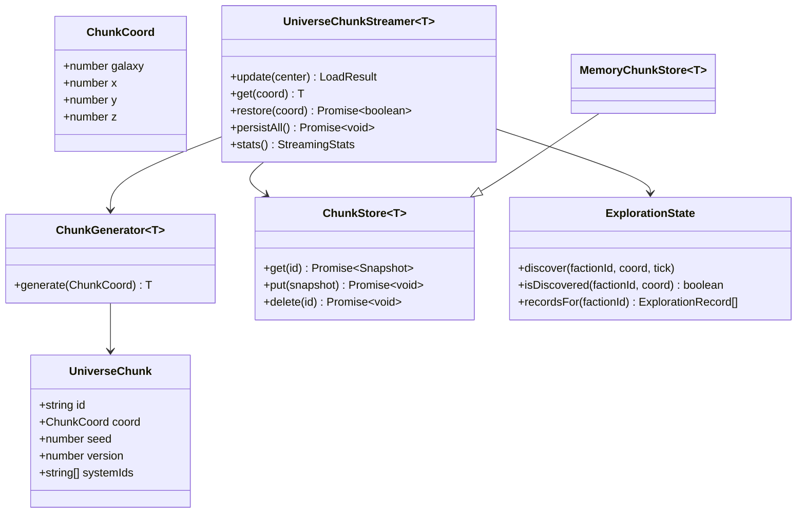

# Universe Streaming UML

The generator is deterministic; the streamer is stateful. This separation allows regenerated procedural data to remain stable while gameplay state, cache state, and fog-of-war state evolve independently.
